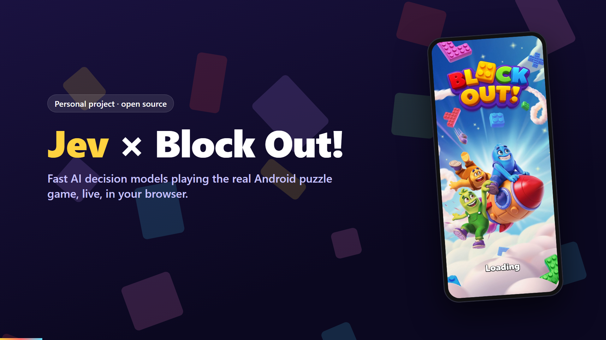

# JEV-block-out

An AI player for the mobile puzzle game **Block Out!**, driven by
[Jev](https://typesafe.ai/blog/introducing-system-one-models-and-jev) — TypeSafe AI's
System One decision model — with a live, watchable simulation of it solving levels.

- 🎮 Game: [Block Out! (com.grandgames.catblockjam) on APKPure](https://apkpure.com/block-out-color-sort-puzzle/com.grandgames.catblockjam)
- 🧠 Model: [Jev by TypeSafe AI](https://typesafe.ai/blog/introducing-system-one-models-and-jev) · [Docs](https://docs.typesafe.ai/introduction)
- 📋 Plan & milestones: [AGENDA.md](./AGENDA.md)
- ✅ Progress tracker: [CHECKPOINTS.md](./CHECKPOINTS.md)
- 📊 Results: [docs/results.md](./docs/results.md)

> **We do not rebuild the game.** The real game runs unmodified in an Android emulator. We read
> its level data, track the board with our own rules engine, and play moves with adb.
> Jev makes every move decision.

### 🎬 50-second demo

[](./docs/media/jev-block-out-demo.mp4)

*Click the image to play [the demo video](./docs/media/jev-block-out-demo.mp4) (MP4, 1080p, 50 s).*


## How it works (Path B+)


1. **State.** The exact starting board comes from the level JSON shipped inside the APK
   ([docs/game-internals.md](./docs/game-internals.md)). After each move our deterministic engine
   computes the next state. Frida hooking was tried and does not work under ARM translation
   ([docs/state-path.md](./docs/state-path.md)).
2. **Decide with Jev.** Each turn the bridge asks Jev three typed questions:
   - `next_move` — **Choice** over the legal moves (≤255), each described in plain English;
   - `progress` — **Score** 0–4, how close to solved;
   - `dead_end` — **Noul**, probability the position is lost.

   Code — not the model — enforces legality. Low confidence (< 0.35) triggers a re-ask with the top
   5 options, then a solver fallback.
3. **Act.** In device mode the move is sent as an adb touch drag; the runner waits until two
   consecutive screenshots match before the next turn.
4. **Watch.** The browser **live arena** runs several deciders side by side on the same level
   (e.g. Gemini vs the solver, or Jev vs Gemini). For each lane it shows every model call as it
   happens (the full request, the raw response, latency, tokens and errors such as 429s), the board
   animating move by move, the probability of each option, and the move list. An optional panel
   mirrors the emulator screen.

Deciders:

| Decider | Model | Latency / move | Cost | Key |
| - | - | - | - | - |
| `jev` | TypeSafe Jev (System One) | ~0.1–0.5 s | $5 free credit with Google login at [console.typesafe.ai](https://console.typesafe.ai) | `TYPESAFE_API_KEY` |
| `clef` | Cloudflare Workers AI **Clef / Clef-flash** (Jev System One compatible, open weights) | ~0.05–0.3 s | **Free:** 10,000 Neurons/day on the Workers Free plan (about 1,000+ moves/day with `clef-flash`) | `CLOUDFLARE_API_TOKEN` + `CLOUDFLARE_ACCOUNT_ID` |
| `openai` | OpenAI **Decisions API** (`gpt-6-luna`), also on Azure OpenAI | ~0.15 s | paid, about $0.10 / M input tokens | `OPENAI_API_KEY` (or `AZURE_OPENAI_API_KEY` + `OPENAI_BASE_URL`) |
| `gemini` | Gemini Flash, general LLM with JSON output | 9–30 s (thinking) | free tier | `GEMINI_API_KEY` |
| `mock` | offline one-ply lookahead softmax | instant | free | – |
| `solver` | weighted A*, plays the optimal plan | instant | free | – |

`auto` picks the first configured one of jev → openai → clef → gemini, else mock. Jev, Clef and
OpenAI Decisions are *decision models*: they score the legal options we send in one forward pass
instead of generating text, which is why they are roughly 100× faster than Gemini here.

## Quick start

Bring your own keys and your own copy of the game, then run one command:

```powershell
git clone https://github.com/mrinal-rangers/JEV-block-out && cd JEV-block-out
npm install
npm start          # first run creates .env: add your keys there, then run npm start again
```

`npm start`:
1. Loads `.env` (gitignored, so your keys never leave your machine) and lists which decision models
   have keys. The offline solver and mock always work.
2. Uses a connected Android device, or boots your first emulator AVD, and opens Block Out! if it is
   installed (see [Playing the real game](#playing-the-real-game-on-the-emulator)).
3. On first run it copies the game APK from that device and extracts its levels into `./levels`
   (needs Python 3; installs the `UnityPy` package). Without a device it uses the demo level.
4. Starts the arena, opens it in your browser and runs two lanes. The real game streams beside them.

Flags: `npm start -- --level 12 --port 5180 --no-emulator --no-levels --no-open --no-autorun`.

Requires Node ≥ 22.18 (runs TypeScript directly, no build step). Other commands:

```powershell
npm test                       # 50 tests
npm run bridge                 # arena only → http://127.0.0.1:5173/?level=demo
npm run play -- demo           # same run in the terminal
```

### Live arena

`npm start` (or `npm run bridge`, then open <http://127.0.0.1:5173>). Pick a level (the list shows hard and super
hard levels), choose a decider for each lane and press **▶ Run all lanes**. Use **+ lane** for up to
8 lanes. Jev appears as `jev (no key)` until `TYPESAFE_API_KEY` is set.

- **Model calls**: one card per API attempt, newest first, with a live timer while waiting.
  Expand **Request** to see the exact prompt or Jev arguments, and **Response** to see the parsed
  answer and the raw body. The API key is never shown.
- **Board and moves**: the board is drawn from our engine state, so it is a mirror of the game
  rather than a re-implementation of it. Each chosen move is animated and listed with how it was
  chosen (confident, re-ask or solver fallback).
- **Real game**: tick **Emulator** to stream the actual game from the emulator as live H.264 video
  (scrcpy-server over adb, decoded in the browser with WebCodecs, ~30 fps). Click the video to tap
  and drag to swipe; **▶ Game**, **◀** and **⌂** open the game, press back and go home. Tick
  **device** on one lane to have its decider play the real game. If the browser lacks WebCodecs or the
  stream fails, the panel falls back to adb screenshots once a second.

URL shortcuts: `?level=12&a=jev&b=solver&delay=200&lanes=2&autorun=1` (`emu=0` hides the
emulator panel). The HTTP API (`POST /run {lane, level, decider}`, `/pause`, `/resume`, `/step`,
`/stop`, `POST /input {type: tap|swipe|key|launch}`, `GET /events` as SSE, `/state`, `/levels`,
`/screen`, `/video`) can also be scripted.

The bundled `examples/demo-level.json` is a synthetic level, so everything above works without the
game. To use real levels, extract them from **your own** copy of the APK (never committed):

```powershell
pip install UnityPy
npm run levels -- path\to\block-out.xapk      # → ./levels (gitignored)
npm run solve -- 1 60                         # offline solver over levels 1–60
npm run play -- 12 --decider jev              # Jev plays level 12 in simulation
npm run play -- 12 --decider gemini           # same with the free Gemini decider
```

Settings are environment variables — see [.env.example](./.env.example).

### Playing the real game on the emulator

**Requirement:** the real game must be installed on an Android emulator (or a phone with USB
debugging). Download Block Out! yourself (e.g. the [APKPure XAPK](https://apkpure.com/block-out-color-sort-puzzle/com.grandgames.catblockjam)
or Google Play) and install it — we never redistribute it:

```powershell
emulator -avd blockout -no-snapshot -no-audio -gpu swiftshader_indirect -no-boot-anim `
  -memory 4096 -cores 4 -feature "-Vulkan,GLESDynamicVersion"
adb install-multiple base.apk config.armeabi_v7a.apk   # files from your XAPK
npm run bridge                                         # tick "Emulator" → live video of the game
npm run play -- 1 --device                             # or tick "device" on a lane
```

On first launch, accept the game's terms yourself in the streamed video (the bot never accepts legal
agreements for you). The streaming server (`scrcpy-server` v5.0.1, Apache-2.0) is downloaded once
into `packages/bridge/.cache/` and checked against its published SHA-256; set `SCRCPY_SERVER` to use
your own copy and `STREAM_MAX_SIZE` to change the resolution (default 720).

Open the level in the game first; the bridge then drives it with adb. Screen calibration is guessed
per board size and can be overridden in `calibration.json`.

## Repo layout

| Path | What |
| - | - |
| `packages/core` | `GameState` types, level parser, rules engine, solver, ASCII renderer |
| `packages/bridge` | Jev / Clef / OpenAI Decisions / Gemini / mock / solver deciders, routing agent, runner, adb device, scrcpy video stream, HTTP/SSE server, CLI, viewer (`public/`) |
| `schema/` | `game-state.schema.json` |
| `examples/` | synthetic demo level + example state |
| `tools/extract_levels.py` | pulls level TextAssets out of your APK |
| `docs/` | game internals, state-path decision, results |

## Tech stack

| Layer | Choice |
| - | - |
| Game runtime | Android emulator, API 30 x86_64 Google APIs image (ARM translation) |
| State | Level JSON from APK (UnityPy) + own rules engine; adb screenshots for settle/verify |
| Bridge | Node.js + TypeScript (native type stripping), `node:http` + SSE |
| Decision model | Jev via `@typesafe-ai/sdk`; Cloudflare Clef (free tier) and OpenAI Decisions API over REST; Gemini as a slow LLM baseline |
| Game stream | scrcpy-server → adb forward → Node → browser WebCodecs `VideoDecoder` (H.264) |
| Viewer | Single-file HTML + canvas |
| Tests | Vitest |

## Jev authentication & cost

- Get an API key from the [TypeSafe console](https://console.typesafe.ai/keys) (early access).
- Store it **only** in a local environment variable `TYPESAFE_API_KEY` (or an untracked `.env`).
  It is used by the PC bridge only — never embedded in the APK, never committed.
- Pricing (published): input $0.042 / MTok, output free. At ~2k tokens/move and ~30 moves/level,
  a level costs roughly **$0.003**.

## Free, fast alternative: Cloudflare Clef

Clef is a Jev System One–compatible decision model on Cloudflare Workers AI, so the `clef` decider
sends exactly the same `next_move` / `progress` / `dead_end` questions as `jev`.

1. Sign up at [dash.cloudflare.com](https://dash.cloudflare.com) (free plan, no card).
2. Copy your **Account ID** (Workers & Pages overview) and create an API token with the
   **Workers AI** template (Profile → API Tokens).
3. `setx CLOUDFLARE_ACCOUNT_ID <id>` and `setx CLOUDFLARE_API_TOKEN <token>`, then open a new terminal.
4. Pick **clef** in the arena. `CLEF_MODEL=clef` uses the larger model (default `clef-flash`).

The free allowance is 10,000 Neurons a day, reset at 00:00 UTC.

## OpenAI Decisions API

`openai` calls `POST /v1/decisions` with a `choice` question over the legal moves, a 5-level
`score` for progress and a `predicate` for dead ends (one request, ~150 ms). Set `OPENAI_API_KEY`
(model `gpt-6-luna`, override with `OPENAI_DECISIONS_MODEL`). For Azure OpenAI set
`AZURE_OPENAI_API_KEY`, `OPENAI_BASE_URL=https://<resource>.openai.azure.com/openai/v1` and
`OPENAI_DECISIONS_MODEL=<deployment name>`.

## Slow baseline: Gemini

No Jev key yet? The `gemini` decider asks the same three questions in one Gemini API call.

1. Sign in with a Google account at [Google AI Studio](https://aistudio.google.com/apikey) and
   create an API key. The free tier needs no credit card.
2. `setx GEMINI_API_KEY <key>` (or put it in an untracked `.env`), then open a new terminal.
3. `npm run play -- demo --decider gemini`, or pick **gemini** in the viewer.

How it maps onto Jev:

| Jev question | Gemini |
| - | - |
| Choice `next_move` | Structured output; the answer is restricted to the legal move ids by a JSON Schema `enum` |
| Choice probabilities | Model's own estimate for its top 5 moves, normalised. **Not calibrated** like Jev's |
| Score `progress` | Number 0–4 on the same rubric |
| Noul `dead_end` | Self-reported probability 0–1 |

Limits: free-tier rate limits are per Google Cloud project and per model. Check them in
[AI Studio](https://aistudio.google.com/rate-limit). The decider waits 4 s between calls by
default (`GEMINI_MIN_INTERVAL_MS`) and times out a call after 60 s (`GEMINI_TIMEOUT_MS`).

The default model is `gemini-3.6-flash`. When it is overloaded (503), rate-limited (429) or
unreachable, the decider switches to `gemini-3.5-flash-lite` (`GEMINI_FALLBACK_MODELS`,
comma-separated). After 10 calls on a fallback model it tries the primary again. A model whose
daily quota is spent is dropped; the decider stops when no models are left. Free-tier prompts may
be used by Google to improve its products, which is fine here because only board states are sent.

Results so far (2026-11-08): Gemini solved the demo (7 moves) and level 1 (3 moves). On level 12
it did not finish within 150 moves; the solver needs 34. The runner never lets any decider return
to a board state it has already seen, unless every legal move would do so. This stops back-and-forth
loops but does not make a weak model plan.

Other free options: GitHub Models (free with a GitHub account), OpenRouter `:free` models, Groq,
and local Ollama with Gemma. None of them give calibrated probabilities either, and none are wired
up yet.

## Legal / repo hygiene

This is a personal research project. **No APKs, game assets or level files are committed** — only
scripts and our own code. The demo level and test fixtures are synthetic. Use a copy of the game you
obtained yourself.

## Status

M0–M3 are built, plus real-game mode. The real game streams into the arena via scrcpy and is
played with adb drags. Level recognition, popup handling and a cached solver plan are all in place.
Level 7 was solved on the real game in 40 moves (~46 s). Jev and Clef run once their keys are set
(`TYPESAFE_API_KEY`, or `CLOUDFLARE_ACCOUNT_ID` + `CLOUDFLARE_API_TOKEN`). See [CHECKPOINTS.md](./CHECKPOINTS.md).