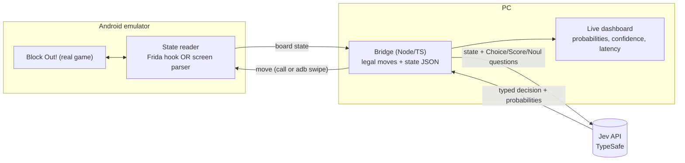

# JEV-block-out

An AI player for the mobile puzzle game **Block Out!**, driven by
[Jev](https://typesafe.ai/blog/introducing-system-one-models-and-jev) — TypeSafe AI's
System One decision model — with a live, watchable simulation of it solving levels.

- 🎮 Game: [Block Out! (com.grandgames.catblockjam) on APKPure](https://apkpure.com/block-out-color-sort-puzzle/com.grandgames.catblockjam)
- 🧠 Model: [Jev by TypeSafe AI](https://typesafe.ai/blog/introducing-system-one-models-and-jev) · [Docs](https://docs.typesafe.ai/introduction)
- 📋 Plan & milestones: [AGENDA.md](./AGENDA.md)
- ✅ Progress tracker: [CHECKPOINTS.md](./CHECKPOINTS.md)

> **We do not rebuild the game.** We run the real game in an Android emulator and mod it
> *just enough* to read the board state and play moves. Jev makes every move decision.

## How it works

1. **Read state** from the running game.
   - **Path A (preferred):** a Frida gadget injected into the APK uses the game's own
     IL2CPP classes (`BoardSnapshot`, `BlockModel`, `CellModel`, `BoardOccupancy`, `CanMove`,
     `CanBlockPassDoor`, …) to export the exact board as JSON.
   - **Path B (fallback, no mod):** level layouts come from the game's cached level files;
     live board is parsed from `adb` screenshots with OpenCV; moves are `adb` swipes.
2. **Decide with Jev.** The bridge lists legal moves and asks Jev a `Choice`
   ("which move?", ≤255 options) plus `Score`/`Noul` questions ("how close to solved?",
   "is this a dead end?"). Code — not the model — enforces legality.
3. **Act.** The chosen move is executed in the game.
4. **Watch.** Emulator screen (scrcpy) side-by-side with a web dashboard streaming
   each decision, its probability distribution, confidence and latency.

## Tech stack

| Layer | Choice |
| - | - |
| Game runtime | Android Studio emulator (Android 13, x86_64 Google APIs image, ARM translation) |
| Mod / state access | Frida gadget + [frida-il2cpp-bridge](https://github.com/vfsfitvnm/frida-il2cpp-bridge) (Path A); adb + OpenCV (Path B) |
| Bridge | Node.js + TypeScript, Fastify, WebSocket/SSE |
| Decision model | Jev via the TypeSafe TypeScript SDK |
| Dashboard | Vite + React |
| Mirroring | scrcpy |
| Tests / CI | Vitest, GitHub Actions |

## Jev authentication & cost

- Get an API key from the [TypeSafe console](https://console.typesafe.ai/keys) (early access).
- Store it **only** in a local environment variable `TYPESAFE_API_KEY` (or an untracked `.env`).
  It is used by the PC bridge only — never embedded in the APK, never committed.
- Pricing (published): input $0.042 / MTok, output free. At ~2k tokens/move and ~30 moves/level,
  a level costs roughly **$0.003**.

## Legal / repo hygiene

This is a personal research project. **No APKs, patched APKs, or game assets are committed
to this repository** — only scripts, patch instructions, and our own code. Use a copy of the
game you obtained yourself.

## Status

🚧 Planning — see [CHECKPOINTS.md](./CHECKPOINTS.md) for live progress and [AGENDA.md](./AGENDA.md) for the plan.
