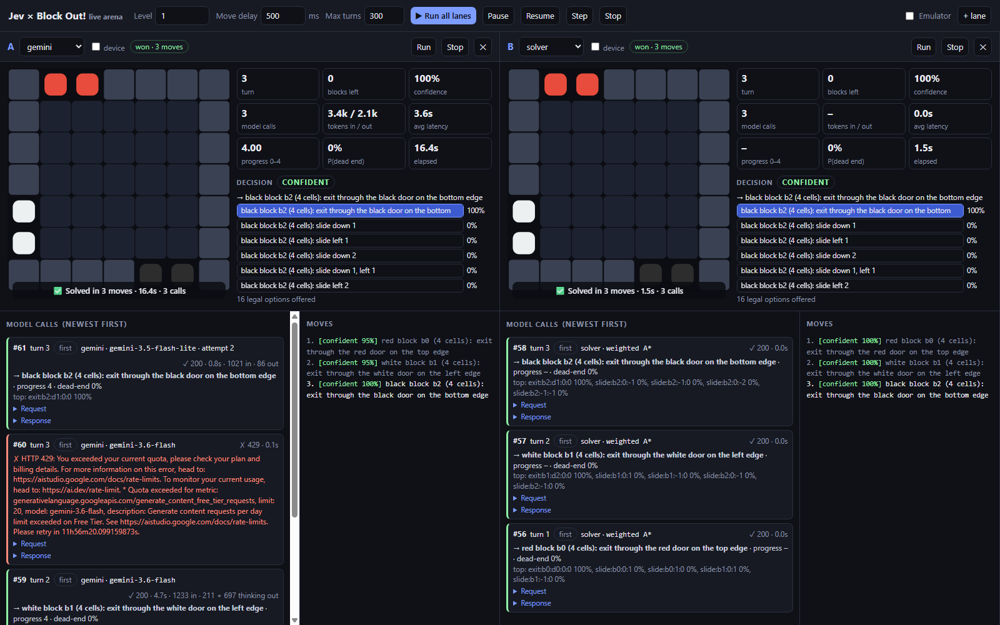
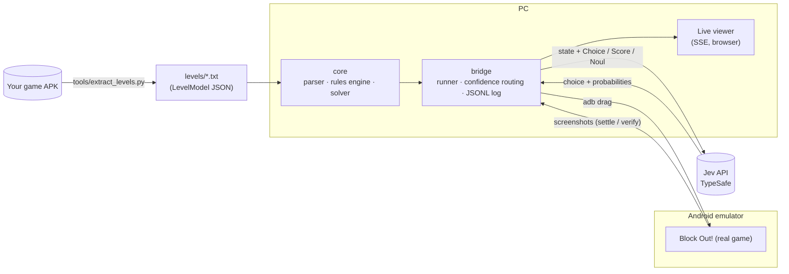

# JEV-block-out

An AI player for the mobile puzzle game **Block Out!**, driven by
[Jev](https://typesafe.ai/blog/introducing-system-one-models-and-jev) — TypeSafe AI's
System One decision model — with a live, watchable simulation of it solving levels.

- 🎮 Game: [Block Out! (com.grandgames.catblockjam) on APKPure](https://apkpure.com/block-out-color-sort-puzzle/com.grandgames.catblockjam)
- 🧠 Model: [Jev by TypeSafe AI](https://typesafe.ai/blog/introducing-system-one-models-and-jev) · [Docs](https://docs.typesafe.ai/introduction)
- 📋 Plan & milestones: [AGENDA.md](./AGENDA.md)
- ✅ Progress tracker: [CHECKPOINTS.md](./CHECKPOINTS.md)
- 📊 Results: [docs/results.md](./docs/results.md)

> **We do not rebuild the game.** The real game runs unmodified in an Android emulator. We read
> its level data, track the board with our own rules engine, and play moves with adb.
> Jev makes every move decision.



## How it works (Path B+)



1. **State.** The exact starting board comes from the level JSON shipped inside the APK
   ([docs/game-internals.md](./docs/game-internals.md)). After each move our deterministic engine
   computes the next state. Frida hooking was tried and does not work under ARM translation
   ([docs/state-path.md](./docs/state-path.md)).
2. **Decide with Jev.** Each turn the bridge asks Jev three typed questions:
   - `next_move` — **Choice** over the legal moves (≤255), each described in plain English;
   - `progress` — **Score** 0–4, how close to solved;
   - `dead_end` — **Noul**, probability the position is lost.

   Code — not the model — enforces legality. Low confidence (< 0.35) triggers a re-ask with the top
   5 options, then a solver fallback.
3. **Act.** In device mode the move is sent as an adb touch drag; the runner waits until two
   consecutive screenshots match before the next turn.
4. **Watch.** The browser viewer animates every move with the probability of each option,
   confidence, progress, P(dead end), latency and which routing step chose the move.

Deciders: `jev` (needs key), `gemini` (free Gemini API key, see below), `mock` (offline stand-in:
one-ply lookahead softmax), `solver` (weighted A*, plays the optimal plan). `auto` = jev if`
`TYPESAFE_API_KEY` is set, else gemini if `GEMINI_API_KEY` is set, else mock.

## Quick start

Requires Node ≥ 22.18 (runs TypeScript directly, no build step).

```powershell
npm install
npm test                       # 33 tests
npm run bridge                 # live viewer → http://127.0.0.1:5173/?level=demo
npm run play -- demo           # same run in the terminal
```

The bundled `examples/demo-level.json` is a synthetic level, so everything above works without the
game. To use real levels, extract them from **your own** copy of the APK (never committed):

```powershell
pip install UnityPy
npm run levels -- path\to\block-out.xapk      # → ./levels (gitignored)
npm run solve -- 1 60                         # offline solver over levels 1–60
npm run play -- 12 --decider jev              # Jev plays level 12 in simulation
npm run play -- 12 --decider gemini           # same with the free Gemini decider
```

Settings are environment variables — see [.env.example](./.env.example).

### Playing on the emulator

```powershell
emulator -avd blockout -no-snapshot -no-audio -gpu swiftshader_indirect -no-boot-anim `
  -memory 4096 -cores 4 -feature "-Vulkan,GLESDynamicVersion"
npm run play -- 1 --device                    # or tick "device" in the viewer
```

Open the level in the game first; the bridge then drives it with adb. Screen calibration is guessed
per board size and can be overridden in `calibration.json`.

## Repo layout

| Path | What |
| - | - |
| `packages/core` | `GameState` types, level parser, rules engine, solver, ASCII renderer |
| `packages/bridge` | Jev / Gemini / mock / solver deciders, routing agent, runner, adb device, HTTP/SSE server, CLI, viewer (`public/`) |
| `schema/` | `game-state.schema.json` |
| `examples/` | synthetic demo level + example state |
| `tools/extract_levels.py` | pulls level TextAssets out of your APK |
| `docs/` | game internals, state-path decision, results |

## Tech stack

| Layer | Choice |
| - | - |
| Game runtime | Android emulator, API 30 x86_64 Google APIs image (ARM translation) |
| State | Level JSON from APK (UnityPy) + own rules engine; adb screenshots for settle/verify |
| Bridge | Node.js + TypeScript (native type stripping), `node:http` + SSE |
| Decision model | Jev via `@typesafe-ai/sdk`; free fallback: Gemini API (REST, no SDK) |
| Viewer | Single-file HTML + canvas |
| Tests | Vitest |

## Jev authentication & cost

- Get an API key from the [TypeSafe console](https://console.typesafe.ai/keys) (early access).
- Store it **only** in a local environment variable `TYPESAFE_API_KEY` (or an untracked `.env`).
  It is used by the PC bridge only — never embedded in the APK, never committed.
- Pricing (published): input $0.042 / MTok, output free. At ~2k tokens/move and ~30 moves/level,
  a level costs roughly **$0.003**.

## Free alternative: Gemini

No Jev key yet? The `gemini` decider asks the same three questions in one Gemini API call.

1. Sign in with a Google account at [Google AI Studio](https://aistudio.google.com/apikey) and
   create an API key. The free tier needs no credit card.
2. `setx GEMINI_API_KEY <key>` (or put it in an untracked `.env`), then open a new terminal.
3. `npm run play -- demo --decider gemini`, or pick **gemini** in the viewer.

How it maps onto Jev:

| Jev question | Gemini |
| - | - |
| Choice `next_move` | Structured output; the answer is restricted to the legal move ids by a JSON Schema `enum` |
| Choice probabilities | Model's own estimate for its top 5 moves, normalised. **Not calibrated** like Jev's |
| Score `progress` | Number 0–4 on the same rubric |
| Noul `dead_end` | Self-reported probability 0–1 |

Limits: free-tier rate limits are per Google Cloud project and per model. Check them in
[AI Studio](https://aistudio.google.com/rate-limit). The decider waits 4 s between calls by
default (`GEMINI_MIN_INTERVAL_MS`) and retries 429/5xx using the server's `retryDelay`. It stops
on a daily-quota error. Free-tier prompts may be used by Google to improve its products, which is
fine here because only board states are sent.

Other free options: GitHub Models (free with a GitHub account), OpenRouter `:free` models, Groq,
and local Ollama with Gemma. None of them give calibrated probabilities either, and none are wired
up yet.

## Legal / repo hygiene

This is a personal research project. **No APKs, game assets or level files are committed** — only
scripts and our own code. The demo level and test fixtures are synthetic. Use a copy of the game you
obtained yourself.

## Status

M0–M3 built: everything runs in simulation, Jev integration is wired up and tested with a mock.
Waiting on the TypeSafe API key and on-device verification — see [CHECKPOINTS.md](./CHECKPOINTS.md).